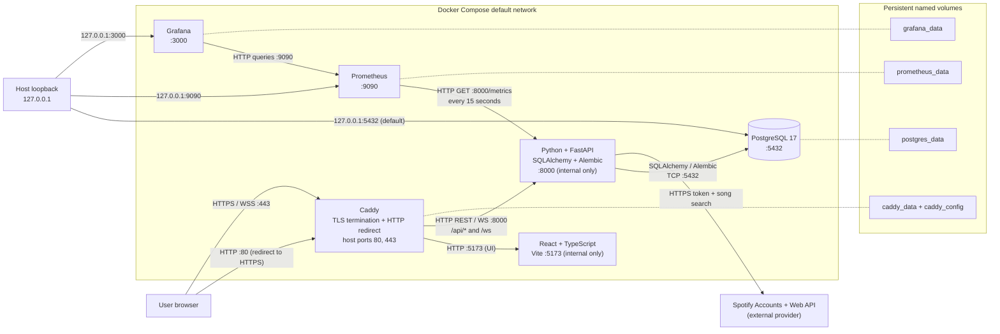

# ft_transcendence

## Description

TODO: Add the final project name, concept, goal, and key features.

ft_transcendence must be a web application with a frontend, backend, database, secure user management, multi-user support, Privacy Policy and Terms of Service pages, and at least 14 validated module points.

## Project Management

TODO: Describe how the team organizes work, distributes tasks, reviews code, communicates, and tracks blockers.

## Technical Stack

| Area | Choice | Justification |
| --- | --- | --- |
| Frontend | React + Vite + TypeScript | Component-based frontend with fast local development. |
| Backend | Python + FastAPI | Lightweight API framework with WebSocket support. |
| Database | PostgreSQL | Relational database for users, profiles, social data, and application state. |
| ORM | SQLAlchemy 2 + Alembic | Typed Python models for every table; Alembic migrations keep the database schema in step with the models. |
| Styling solution | TODO | TODO |
| Deployment | Docker Compose | Runs the application services through a single development stack. |

## System Architecture



Caddy serves the Vite frontend and sends `/api/*` and `/ws` directly to FastAPI. Browser traffic uses HTTPS/WSS; proxy traffic inside Compose uses HTTP/WS. Only Caddy publishes ports on all host interfaces. PostgreSQL, Prometheus, and Grafana publish loopback-only ports; the frontend and backend have no host ports. The PostgreSQL host port defaults to 5432 and can be changed with `POSTGRES_PORT`. The backend runs Alembic migrations before starting. Spotify is the only merged external API integration shown here; 42 OAuth has not merged into `main`. Avatar upload is available, and confirmed account deletion permanently removes the user row and its dependent data.

## Database Schema

PostgreSQL, accessed only through the SQLAlchemy ORM. Every table is a class in `backend/app/db/models.py`.

```mermaid
erDiagram
    users ||--|| profiles : "has"
    users ||--o{ sessions : "logs in with"
    users ||--o{ top10_entries : "ranks"
    songs ||--o{ top10_entries : "is ranked in"
    users ||--o{ friendships : "asks / is asked"
    users ||--o{ blocks : "blocks / is blocked"
    users ||--o{ top10_comments : "owns / writes"
    users ||--o{ top10_reactions : "owns / reacts"
    users ||--o{ notifications : "receives / causes"
    users ||--o{ messages : "sends / receives"
    users ||--o| avatars : "uploads"

    users {
        bigint id PK
        varchar email UK
        varchar password_hash
        int failed_login_count
        timestamptz locked_until
        timestamptz deleted_at
    }
    profiles {
        bigint id PK
        bigint user_id FK,UK
        varchar display_name
        varchar avatar_url
        boolean is_top10_public
        boolean is_online
    }
    sessions {
        bigint id PK
        bigint user_id FK
        varchar token_hash UK
        timestamptz expires_at
    }
    songs {
        bigint id PK
        varchar provider
        varchar provider_id
        varchar title
        varchar artist
    }
    top10_entries {
        bigint id PK
        bigint user_id FK
        bigint song_id FK
        int rank "1-10, unique per user"
    }
    friendships {
        bigint id PK
        bigint requester_id FK
        bigint addressee_id FK
        varchar status "pending, accepted, declined"
    }
    blocks {
        bigint blocker_id PK,FK
        bigint blocked_id PK,FK
    }
    top10_comments {
        bigint id PK
        bigint top10_owner_id FK
        bigint author_id FK
        varchar body
    }
    top10_reactions {
        bigint id PK
        bigint top10_owner_id FK
        bigint author_id FK
        varchar reaction "like or dislike"
    }
    notifications {
        bigint id PK
        bigint recipient_id FK
        bigint actor_id FK "may be empty"
        varchar event_type
        varchar event_key
        timestamptz read_at
    }
    messages {
        bigint id PK
        bigint sender_id FK
        bigint recipient_id FK
        varchar body "1-1000 chars"
        timestamptz created_at
    }
    avatars {
        bigint user_id PK,FK
        bytea data "256x256 WebP"
        timestamptz updated_at
    }
```



| Table | Holds | Key fields and rules |
| --- | --- | --- |
| `users` | Accounts | `email` unique and lowercase, `password_hash` (argon2, never the password), failed login counter and `locked_until` for lockout, `deleted_at` for GDPR soft delete |
| `profiles` | Public profile, one per user | `display_name`, `avatar_url`, `bio`, `is_top10_public`, `is_online`, `last_seen_at` |
| `sessions` | Logged-in browsers | `token_hash` (SHA-256 of the cookie token; the token itself is never stored), `expires_at` |
| `songs` | Songs from Spotify or added by hand | unique `(provider, provider_id)`, `title`, `artist`, `album`, `cover_url` |
| `top10_entries` | A user's Top 10 | `rank` 1 to 10; each rank and each song at most once per user |
| `friendships` | Friend requests and friends | `requester_id`, `addressee_id`, `status` pending / accepted / declined; one row per pair whatever the direction; nobody can befriend themselves |
| `blocks` | Who blocked whom | primary key `(blocker_id, blocked_id)`; nobody can block themselves |
| `top10_comments` | Comments on a Top 10 | `top10_owner_id`, `author_id`, `body` (never blank) |
| `top10_reactions` | Like or dislike on a Top 10 | one reaction per user per Top 10; `like` or `dislike` only; not on your own Top 10 |
| `notifications` | Events shown to a user (friend requests, comments, reactions) | `recipient_id`, `actor_id` (who caused it, may be empty), `event_type`, `message`, `read_at`; unique `(recipient_id, event_key)` so the same event is stored once; index on `(recipient_id, created_at)` for the newest-first list |
| `messages` | Private chat messages between two users | `sender_id`, `recipient_id`, `body` (1 to 1000 characters, never blank), `created_at`; nobody can message themselves; index on `(sender_id, recipient_id, created_at, id)` for a conversation, newest first |
| `avatars` | Uploaded profile pictures, at most one per user | `user_id` (primary key), `data` (the image re-encoded to a 256x256 WebP, metadata removed), `updated_at`; without a row, `profiles.avatar_url` points at the default image |

Types: ids and foreign keys are `BIGINT`, text fields are `VARCHAR`, times are `TIMESTAMPTZ` (with time zone), flags are `BOOLEAN`, other numbers (`rank`, `failed_login_count`, `duration_ms`) are `INTEGER`, `songs.metadata` is `JSON`, and `avatars.data` is `BYTEA` (raw bytes).

Deleting a user's row deletes their profile, sessions, Top 10, friendships, blocks, comments, reactions, received notifications, messages they sent or received and their avatar (`ON DELETE CASCADE`). Ending a friendship keeps the messages. Notifications they caused for others stay, with `actor_id` cleared and the remaining notification text and source key anonymized. Account deletion from the app requires an emailed confirmation token and hard-deletes the user row. A song cannot be deleted while it is in someone's Top 10 (`ON DELETE RESTRICT`).

The rules above are enforced by PostgreSQL itself (unique indexes, `CHECK` constraints, foreign keys), not only by the application code, so concurrent requests cannot break them.

### ORM and migrations

- **Models** (`backend/app/db/models.py`): SQLAlchemy 2 declarative classes with typed columns and relationships, for example `user.profile`, `friendship.requester`, `comment.author`. Routes and helpers read and write through these classes; the app sends no hand-written SQL (checked by `backend/tests/test_orm_end_to_end.py`).
- **Migrations** (`backend/alembic/versions/`): Alembic compares the models with the database and generates one migration per schema change. `make migrate` runs `alembic upgrade head` and brings an empty or old database to the current schema.
- **Changing the schema**: edit the model, generate a migration with `alembic revision --autogenerate`, review it, then run `make migrate`. `alembic check` reports any model change that has no migration yet.

## Features List

| Feature | Description | Contributor(s) |
| --- | --- | --- |
| TODO | TODO | TODO |

## Modules

Major modules count as 2 points. Minor modules count as 1 point. The project must reach at least 14 validated module points.

| Module | Type | Points | Justification | Implementation | Contributor(s) |
| --- | --- | ---: | --- | --- | --- |
| Prometheus and Grafana monitoring | Major | 2 | Backend metrics, a provisioned dashboard with live request, latency, and WebSocket data, an availability alert that fires and recovers, and authenticated localhost-only Grafana access survived a restart. | [Monitoring guide](monitoring/README.md) and [live acceptance evidence](monitoring/acceptance-evidence.md) | jomunoz |
| TODO | TODO | TODO | TODO | TODO | TODO |

Validated module points listed above: 2

Total planned points: TODO

## Individual Contributions

| Member | Contributions | Challenges and Solutions |
| --- | --- | --- |
| jomunoz | TODO | TODO |

## Instructions

### Prerequisites

- Docker with Docker Compose
- Make

### Environment

Create the local environment file from the committed template:

```bash
cp .env.example .env
```

Fill in the local values in `.env`. This file contains local configuration and secrets and must remain ignored by Git.

See [realtime development](docs/realtime.md) for WebSocket origins, HTTPS,
presence events, logout behavior, and integration tests.

See [advanced song search](docs/advanced-search.md) for the PostgreSQL search API,
offline demo seed, frontend controls, and verification commands.

### Run

Build and start the complete application:

```bash
make up
```

Compose waits for PostgreSQL to become healthy, then the backend applies pending
Alembic migrations before starting the API. No manual `make migrate` is needed.
Each backend start checks for pending migrations; an up-to-date database keeps
its existing data. If migration fails, the backend logs the error and exits
without serving requests (Compose's restart policy retries it).

Open `https://localhost` (or `https://127.0.0.1`) after trusting the local
certificate as described below. Caddy redirects HTTP on port 80 to HTTPS on
port 443, serves Vite, and forwards `/api/*` and `/ws` to FastAPI, including
WebSocket upgrades. API calls use the page's HTTPS origin and WebSockets use WSS.

Vite and FastAPI have no published host ports; ports 5173 and 8000 are internal
to Docker. Source mounts, Vite hot reload, and backend reload remain available.
Prometheus still scrapes `http://backend:8000/metrics` inside Docker. Existing
`.env` files should set
`WEBSOCKET_ALLOWED_ORIGINS=https://localhost,https://127.0.0.1`; `BACKEND_PORT`
is no longer used. Keep the same hostname throughout login and WebSocket use.

### Trust local HTTPS (once per machine/browser)

Caddy generates certificates automatically and keeps its local CA in the
`caddy_data` volume. After `make up`, run in another terminal:

```bash
mkdir -p .scratch
docker compose exec -T caddy cat /data/caddy/pki/authorities/local/root.crt > .scratch/caddy-root.crt
```

Use `docker-compose` instead if using standalone Compose v1. On Debian/Ubuntu,
trust this public root certificate for command-line clients:

```bash
sudo cp .scratch/caddy-root.crt /usr/local/share/ca-certificates/ft-transcendence-caddy.crt
sudo update-ca-certificates
```

In Chrome, open Settings → Privacy and security → Security → Manage certificates
and import `.scratch/caddy-root.crt` into the local trusted authorities for
identifying websites, then restart Chrome. Other systems can import the same
certificate into their system trust store; see
[Caddy's local HTTPS instructions](https://caddyserver.com/docs/running#local-https-with-docker).
Only export `root.crt`, never the CA private key. `.scratch` is ignored by Git.
`make down` preserves the CA; deleting `caddy_data` (including via `make db-reset`)
requires exporting and trusting the new CA again.

Verify TLS without bypassing certificate validation:

```bash
curl --cacert .scratch/caddy-root.crt -I https://localhost
curl --cacert .scratch/caddy-root.crt -i https://localhost/api/v1/auth/me
```

The second request should return `401` when logged out. In Chrome, verify a trusted
address bar, registration/login/logout, the `Secure` session cookie, HTTPS API
requests, a `wss://localhost/ws` connection with status `101` after login, and
Vite hot reload. Check DevTools for certificate, mixed-content, or WebSocket
errors. Direct HTTP access on ports 8000 and 5173 should fail.

### Stop and development commands

To stop the application:

```bash
make down
```

Useful development commands:

```bash
make logs
make status
make test
make migrate
```

### Fresh-deployment smoke test

Use a separate checkout and a new, unique Compose project name to isolate
the database and Caddy certificate volumes. Ensure ports 80, 443, 5432,
3000 and 9090 are free. Never run `make db-reset` or `down -v` against
your normal project.

In the disposable checkout, configure `.env` from `.env.example`, including
`GRAFANA_ADMIN_PASSWORD` and the HTTPS WebSocket origins, then:

```bash
# Save the unique project name in this checkout's .env for all terminals.
printf '\nCOMPOSE_PROJECT_NAME=ft48-smoke-%s\n' "$(date +%s)" >> .env
make up
```

Wait for Alembic migration logs followed by Uvicorn's startup message.
Caddy uses its own local CA for this isolated Compose project. Export the
certificate using the instructions in "Trust local HTTPS" above, from this
checkout, then run:

```bash
curl --cacert .scratch/caddy-root.crt --fail-with-body https://localhost/
curl --cacert .scratch/caddy-root.crt --fail-with-body -i https://localhost/api/v1/auth/register \
  -H 'Content-Type: application/json' \
  -d '{"email":"deployment-smoke@example.com","password":"smoke-password-48","display_name":"Deployment smoke"}'
```

Registration must return HTTP 201; save the returned user ID. Run `make down`
and then `make up` again, keeping the same `.env` and volumes. Once ready:

```bash
curl --cacert .scratch/caddy-root.crt --fail-with-body -i https://localhost/api/v1/auth/login \
  -H 'Content-Type: application/json' \
  -d '{"email":"deployment-smoke@example.com","password":"smoke-password-48"}'
```

Login must return HTTP 200 with the same user ID and display name, proving the
account and profile survived. Stop the disposable stack with `make down`.
Do not remove the normal project's volumes.

## Resources

TODO: Add documentation, articles, tutorials, and references used by the team.

### AI Usage

TODO: Explain which AI tools were used, for which tasks, and which parts of the project were AI-assisted.

## Notes

The subject and correction sheet PDFs are kept in the repository root for reference.

