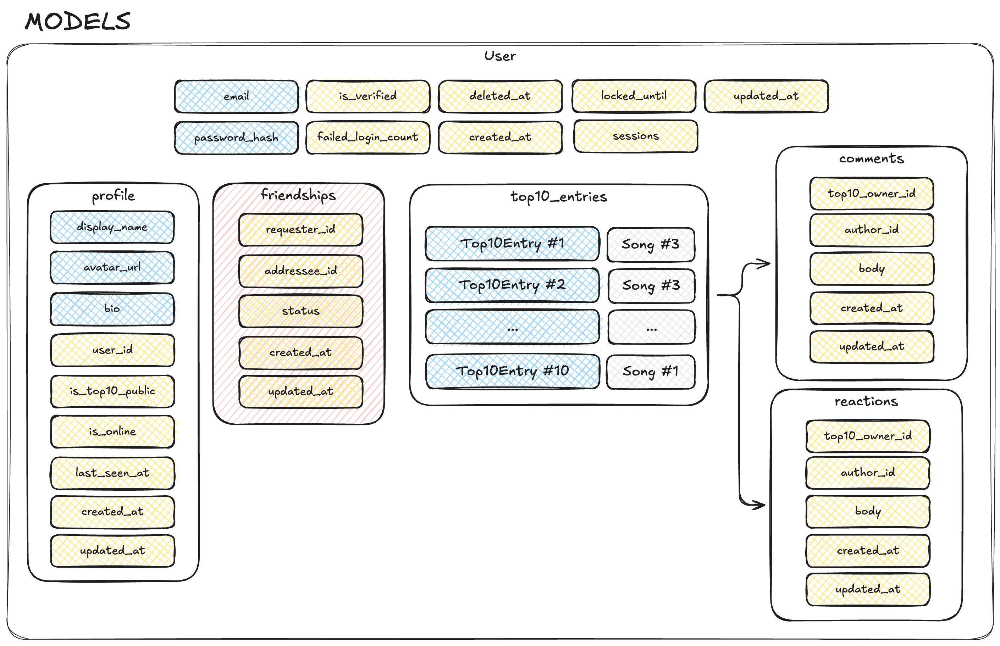
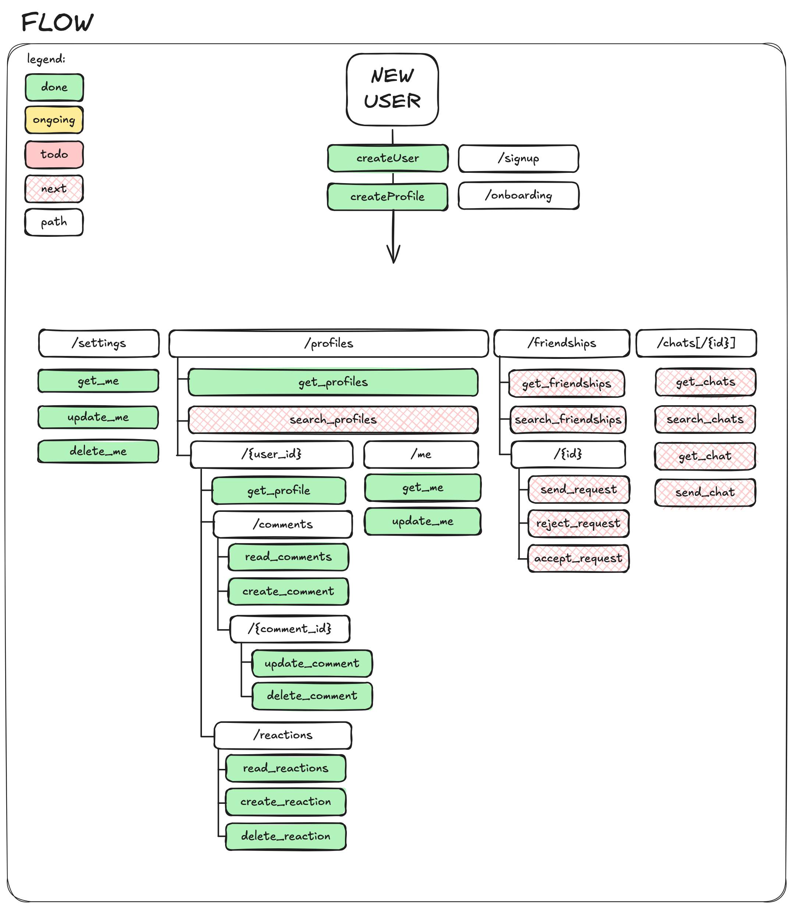
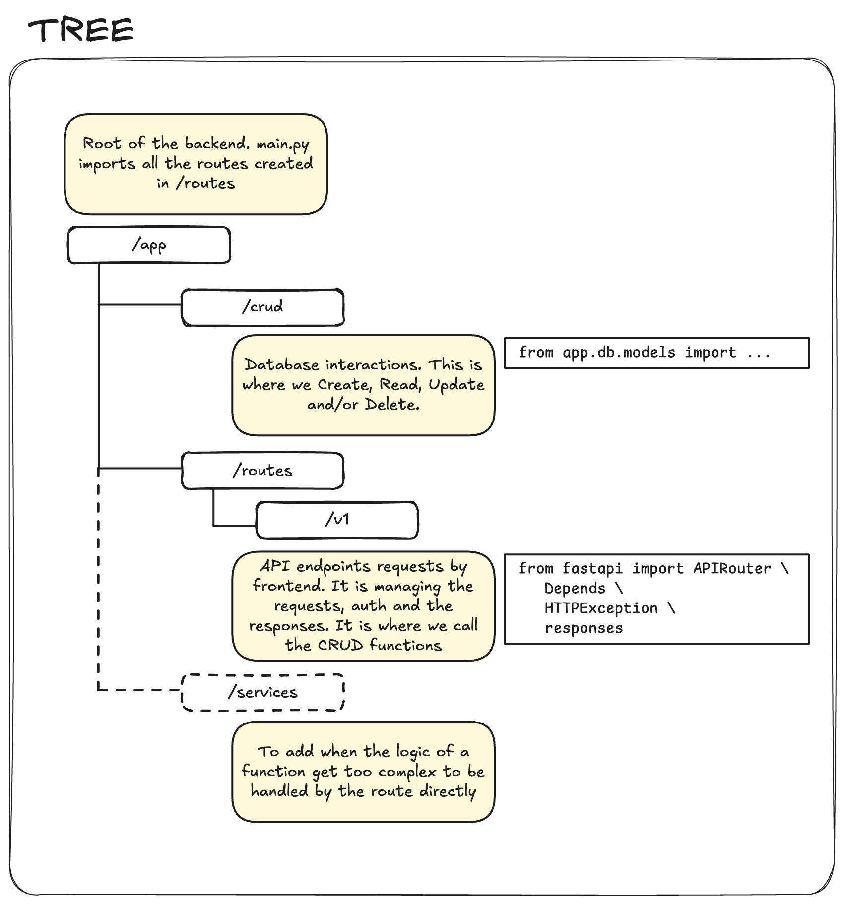

# Backend Development

Backend workspace for **ft_transcendence**, primarily maintained by Victor.

## Stack

- Python 3.14
- FastAPI
- Uvicorn
- Docker

PostgreSQL and SQLAlchemy are wired up (ticket 02). Alembic migrations follow in ticket 03.

## Current State

The backend has been initialized with a minimal FastAPI application.

`GET /health` queries the database on every call: 200 with `{"status": "ok", "database": "ok"}` when it is reachable, 503 with `{"status": "error", "database": "unreachable"}` when it is not. A readiness check that stays green while the database is down would be useless.

`app/db.py` is the single place an engine is built and sessions are handed out. Anything needing a session depends on `get_session`; nothing else creates its own engine.

The backend has been tested both locally and inside Docker.

Database and authentication details are documented under `docs/andre_docs_code/`;
this page focuses on running and testing the backend transport.

## WebSocket Transport

`ws://localhost:8000/ws` accepts WebSocket connections. Clients send plain text
frames. Each received text frame is broadcast to every currently connected
client, including its sender, as JSON:

```json
{
  "type": "message",
  "data": {
    "text": "the original text"
  }
}
```

Connections are accepted and stored in the process-wide `ConnectionManager`.
A normal client disconnect, an unexpected endpoint error, or a failed send
removes the affected connection. A failed send does not stop delivery to the
other connected clients.

This transport is currently anonymous: it does not authenticate connections,
associate them with users, track presence, or support private messages. Its
connection list exists only in memory and is not shared between processes, so
it is suitable only for the current single-process development setup.

## Tests

```bash
make test        # from the repo root
```

Runs pytest inside the backend container. `backend/` is bind-mounted into the image, so edits do not need a rebuild.

Run only the transport tests without starting PostgreSQL:

```bash
docker compose run --rm --no-deps backend pytest tests/test_websocket.py
```

The transport tests exercise the FastAPI ASGI application in-process. They do
not open browsers or query a database.

## Manual WebSocket Check

1. Run `make up` from the repository root.
2. Open `http://localhost:5173` in two browser tabs.
3. Click **Connect WebSocket** in both tabs.
4. Send a message from either tab and confirm that the same message appears in
   both tabs, including the sender.
5. Close one tab, then send another message from the remaining tab and confirm
   that it still receives the broadcast.

## Run Locally

From `backend/`:

```bash
python3 -m venv .venv
source .venv/bin/activate
pip install -r requirements.txt
uvicorn app.main:app --reload
```

## Models


## Flow


## Tree


## Coding practices

#### Routes
```python
from fastapi import APIRouter, Depends, HTTPException, responses

router = APIRouter()

@router.get("/")
def get_all():
	...
```

#### HTTP Exceptions
```python
# /app/crud/xxx
class Error<ErrorName>(Exception):
    pass

...
except:
	raise Error<ErrorName>("Error when reading profiles")

# /app/routes/xxx
from fastapi import HTTPException

...
except Exception as error:
	raise HTTPException(status_code=400, detail=str(error))
```
